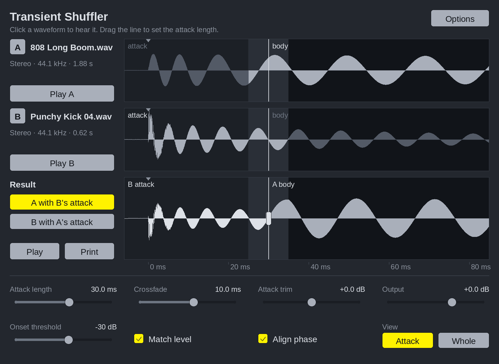

# Transient Shuffler

A REAPER plug-in (JSFX) that gives one sample the attack of another. Drop two
samples on it. The result keeps **A's body** (its sustain and tail) and takes
**B's attack**, or the other way round.



## Install

1. Copy `TransientShuffler.jsfx` into REAPER's `Effects` folder (*Options →
   Show REAPER resource path*, then open `Effects`).
2. On a track, add the FX **JS: Transient Shuffler**.

Needs REAPER 6.05 or later.

## Use

- **Drop samples.** Drop a file on row A or row B, or drop two files at once
  to fill both. REAPER reads WAV, AIFF, FLAC, MP3 and OGG. Each sample can be
  up to 16 seconds long at 48 kHz.
- **Choose the result.** *A with B's attack* or *B with A's attack*.
- **Listen.** Click any waveform, use the Play buttons, or play MIDI notes
  into the track. Velocity sets the level.
- **Set the splice.** Drag the line in the waveforms, or use *Attack length*.
  All three rows share one time axis, lined up on each sample's hit, so you
  can see which part of each sample is used. Parts that are used are drawn
  light and parts that aren't are drawn dark.
- **Print.** Adds the result to the project as a new item.

Samples are remembered by their file path and load again when you reopen the
project.

| Control | What it does |
| --- | --- |
| Attack length | How much of the start comes from the attack sample. |
| Crossfade | How long the attack takes to blend into the body. |
| Attack trim | Turns the borrowed attack up or down. |
| Output | The level of what plays. It doesn't change what gets printed. |
| Onset threshold | How close to its peak a sample must get before its hit counts as started. |
| Match level | Scales the borrowed attack so its peak matches the attack it replaces. |
| Align phase | Shifts the body by up to 2.5 ms, and flips it if that matches better, so the splice adds up instead of cancelling. |
| View | *Attack* zooms in on the splice. *Whole* shows everything. Scroll over the waveforms to zoom. |
| Options | Pass input audio through, choose what MIDI notes play, clear a sample. |

Keys (when the window has focus): Space plays the result, Esc stops, 1 and 2
choose the result, A and B play the samples.

## How the swap works

1. Each sample's hit is found: the first moment it gets within the onset
   threshold of its peak. The two hits are lined up.
2. Up to the attack length, the result is the attack sample, starting 5 ms
   before the hit so the rise isn't cut.
3. At the attack length the two samples crossfade. The shape of the
   crossfade depends on how similar the two are at that point, so the level
   stays even whether they are alike or not.
4. After the crossfade, the result is the body sample, unchanged.

## Design

- **Colours.** The house scheme, from Miderator's `Theme.h`: a dark cool-grey
  background, light grey controls with dark text, one yellow for whatever is
  on, sounding or being dragged, and red only for errors.
- **Apple's Human Interface Guidelines.**
  - The waveforms come first.
  - You edit by dragging the waveform itself.
  - Every click gets feedback right away.
  - Unavailable controls are dimmed, not hidden.
  - Labels are in plain language, and the line under the title explains
    whatever is under the pointer.
  - Light and dark show which parts are used, so it works without colour.
  - Your original samples are never changed.

## Tests

The plug-in's own code runs outside REAPER in WDL's EEL2 interpreter, with
REAPER's calls replaced by stand-ins:

```sh
# build the interpreter once, from https://github.com/justinfrankel/WDL
cd WDL/eel2 && make NO_GFX=1 MAXLOOP=1048576 loose_eel
python3 tests/run_tests.py path/to/loose_eel        # 230 checks
python3 tests/render_preview.py path/to/loose_eel out/   # pictures of the window
```

The tests check that:

- each hit is found;
- the attack, the crossfade and the body all come out exactly right;
- a sample given its own attack comes back unchanged, even flipped upside
  down;
- the level holds through the crossfade;
- loading converts the sample rate, filters out content above the new
  Nyquist, and folds surround down to stereo;
- playback, printing and saving with the project work;
- the window's dragging, clicking and zooming work.

Two things only REAPER can confirm: how files are read, and where *Print*
puts the new item. Print should put it on this track.
