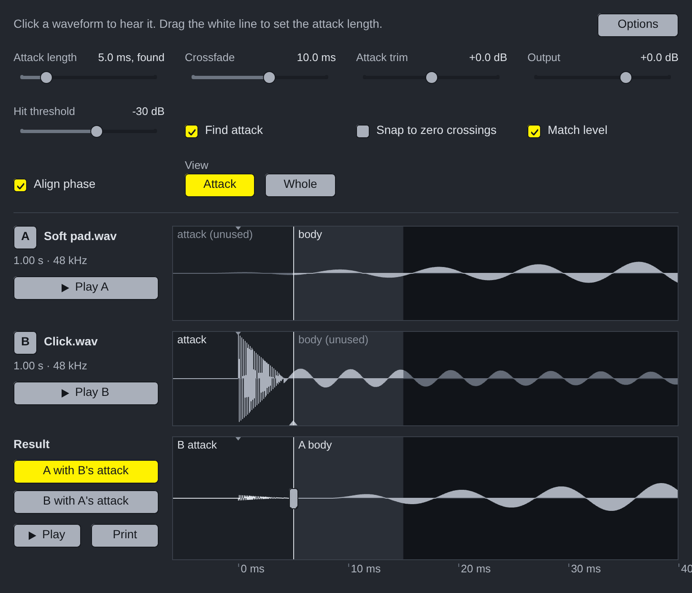

# Transient Shuffler for Ableton Live

A Max for Live instrument. The splicing is `TransientShuffler.jsfx` itself, running in the device's window on Middaw's runtime; the playing is the same plug-in translated to gen~, held sample for sample to the JSFX.

## Installing

Needs **Live 12.1 or later with Max for Live** (Live Suite, or Standard with
the add-on): the device runs on Max 9's JavaScript engine (`[v8ui]`).

1. Copy `Transient Shuffler.amxd`, `TransientShuffler.js` and `TransientShuffler.maxpat` into one folder, for
   example `Music/Ableton/User Library/Presets/Instruments/Max Instrument/`. The `.amxd` finds
   `TransientShuffler.js` beside it.
2. Drag `Transient Shuffler.amxd` onto a MIDI track, as its instrument.
3. Optional: open it in the Max editor and click **Freeze Device**, then save.
   The device then carries the script inside it and can be moved on its own.

## Using it

| | |
| --- | --- |
| **Sample A, Sample B** | Drop a sound on each. A buffer~ reads it (any format Live reads), the plug-in finds the attacks and builds both results, as it does when a file is dropped on its window in REAPER. |
| **Show Window** | Opens Transient Shuffler's own window: the waveforms, the attack line, the result and every control. Its Play buttons play through the device. |
| The device | Play it from the track's MIDI: **MIDI notes play** chooses the result, A or B, as in REAPER. |

The controls and the two sounds' paths are saved with the Live set; the sounds are read again from those paths when the set opens.

## How it is built

`ableton/device.json` describes the device; `python3 ableton/kit/build.py
ableton/device.json` writes the `.amxd`, the `.maxpat` and the script bundle
`TransientShuffler.js`. The bundle is Middaw's EEL2 runtime, `TransientShuffler.jsfx` for the window and the splicing, and `ableton/actions.js` (reading sounds, copying them to gen~); the gen~ code inside the device is `TransientShuffler.jsfx` translated by `ableton/kit/jsfx2gen.js` at build time, with its memory in a buffer~ the window writes. See `ableton/kit/VENDORED.md`.

`node --test ableton/tests/test_device.js` loads two sounds through the strip's drops, checks both results are built and copied frame for frame to the memory gen~ plays from, then plays a note through the gen~ code read back out of the built device beside Middaw's runtime playing the same note: the same samples, within 10⁻⁶. It also checks a saved set reads its sounds again, the window draws and answers clicks, and every control reaches gen~. `node ableton/window.js` redraws the picture above from the device's own drawing code (it needs Playwright's Chromium).

## Limits

- **It has not been opened in Live yet.** It is tested in Node against a stand-in for Max and the Live Object Model; nothing has run in Max. If the `.amxd` will not open, open `TransientShuffler.maxpat` in Max and save it as a device.
- **gen~ has not compiled this code yet.** The tests run the very text in the device as JavaScript and match Middaw's runtime to within 10⁻⁷, but only Max can say gen~ accepts it. If it does not, the Max window names the line; `ableton/kit/jsfx2gen.js` is where to fix it.
- The window's controls are not Live parameters, so they cannot be automated or mapped; they are saved with the set.
- Anything the window draws from the sound itself (a meter, a scope) stays still: the window's copy of the plug-in does not hear the audio.
- **Print** writes a file into the REAPER project, which a device cannot do in Live; record the device's output instead.
- Sounds are dropped on the device strip, not on the window: the window cannot see a drop.
- The two sounds take 32 MB of memory in the device (EEL2's memory, as a buffer~), as they did in REAPER.
